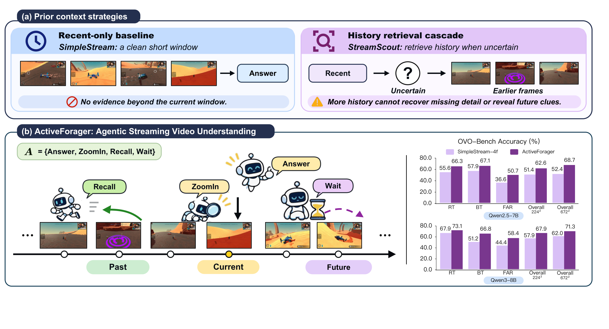
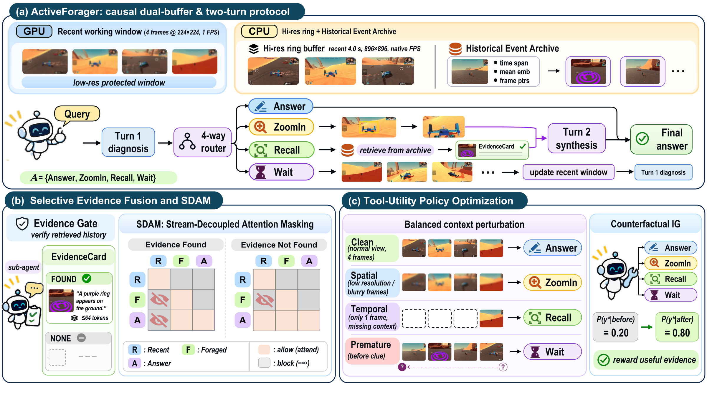
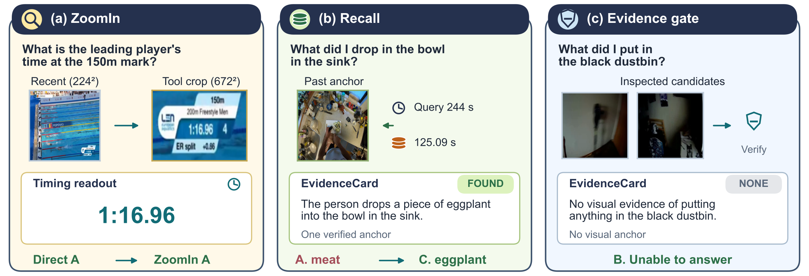

# ActiveForager

<p align="center">
  <strong>Look Closer, Look Back, or Wait for Agentic Streaming Video Understanding</strong>
</p>

<p align="center">
  <a href="#method">Method</a> ·
  <a href="#headline-results">Results</a> ·
  <a href="#quick-start">Quick start</a> ·
  <a href="#training">Training</a> ·
  <a href="#evaluation">Evaluation</a> ·
  <a href="#citation">Citation</a>
</p>

**ActiveForager** is a streaming video agent that starts from the four most recent frames and acquires additional evidence on demand. It can answer directly, inspect fine detail in the current scene, verify an earlier event, or wait for a clue to appear.

<p align="center">
  
</p>

## Method

A compact GPU working window handles routine queries. A CPU ring buffer stores recent frames at higher resolution, and an event archive indexes earlier frames. The policy chooses one action from the current video prefix.

| Action | Behavior |
| --- | --- |
| `Answer` | Answer from the recent working window. |
| `ZoomIn` | Inspect a high-resolution crop or a denser burst of recent frames. |
| `Recall` | Retrieve candidate past events and verify them in an isolated context using the same VLM weights. |
| `Wait` | Advance the stream and reassess the question as new frames arrive. |

<p align="center">
  
</p>

For `Recall`, a verified `EvidenceCard` contributes one anchor frame and a factual note. A `NONE` card contributes zero historical visual tokens. **Stream-Decoupled Attention Masking (SDAM)** isolates the recent and acquired visual streams during answer synthesis. **Tool-Utility Policy Optimization (TUPO)** trains selective routing with balanced context perturbations and a counterfactual reward based on how much the acquired evidence increases the correct answer's likelihood under a frozen reference model.

<p align="center">
  
</p>

## Headline results

ActiveForager reaches **71.30% overall accuracy** on OVO-Bench with Qwen3-VL-8B at 672 × 672, using **64% fewer main-context visual tokens** than StreamScout-R with the same backbone. RT, BT, and FAR measure real-time perception, backward tracing, and forward active responding, respectively. Accuracy is reported in percent.

| Backbone | Base window | Method | Main-context visual tokens ↓ | RT ↑ | BT ↑ | FAR ↑ | Overall ↑ |
| --- | --- | --- | ---: | ---: | ---: | ---: | ---: |
| Qwen2.5-VL-7B | 224 × 224 | SimpleStream-4f | 255.5 | 55.60 | 57.86 | 36.60 | 51.41 |
| Qwen2.5-VL-7B | 224 × 224 | **ActiveForager** | 295.1 | 66.27 | 67.11 | 50.65 | **62.57** |
| Qwen2.5-VL-7B | 672 × 672 | SimpleStream-4f | 2,299 | 62.80 | 47.46 | 36.60 | 52.41 |
| Qwen2.5-VL-7B | 672 × 672 | **ActiveForager** | 2,314 | 77.08 | 70.14 | 50.65 | **68.74** |
| Qwen3-VL-8B | 224 × 224 | SimpleStream-4f | 255.5 | 67.93 | 51.16 | 44.38 | 57.85 |
| Qwen3-VL-8B | 224 × 224 | **ActiveForager** | 409.2 | 73.06 | 66.84 | 58.43 | **67.85** |
| Qwen3-VL-8B | 672 × 672 | SimpleStream-4f | 2,299 | 75.67 | 52.25 | 44.38 | 61.99 |
| Qwen3-VL-8B | 672 × 672 | StreamScout-R | 6,559 | 79.84 | 75.52 | 45.96 | 70.29 |
| Qwen3-VL-8B | 672 × 672 | **ActiveForager** | 2,354 | 78.03 | 70.69 | 58.43 | **71.30** |

### Zero-shot transfer

Overall accuracy (%) from SimpleStream-4f to ActiveForager without target-benchmark fine-tuning.

| Benchmark | Base window | Qwen2.5-VL-7B | Qwen3-VL-8B |
| --- | --- | ---: | ---: |
| StreamingBench | 224 × 224 | 50.83 → **66.11** | 60.28 → **68.61** |
| StreamingBench | 672 × 672 | 45.28 → **74.17** | 53.89 → **72.50** |
| Video-Holmes | 224 × 224 | 17.14 → **32.14** | 23.57 → **47.14** |

## Quick start

Use Python 3.10 or newer. Run the commands from the repository root.

```bash
git clone https://github.com/TiezMind/ActiveForager.git
cd ActiveForager
python -m pip install -e .
```

Run a CPU smoke test on synthetic streams. This exercises both the SimpleStream baseline and ActiveForager without downloading model weights or benchmark videos.

```bash
python -m scripts.eval_ovobench --backend mock --samples-per-task 1 --output-json outputs/ovobench-mock.json
```

## Training

The bundled [training manifests](data/manifest_summary.json) contain 6,000 cold-start SFT trajectories and 8,000 RL prompts. For real-video training, make the source media available locally and point the `video_path` fields in the JSONL files to those files. Start with a local copy of [Qwen2.5-VL-7B-Instruct](https://huggingface.co/Qwen/Qwen2.5-VL-7B-Instruct) or [Qwen3-VL-8B-Instruct](https://huggingface.co/Qwen/Qwen3-VL-8B-Instruct).

| Stage | Manifest | Entry point |
| --- | --- | --- |
| Cold-start SDAM-SFT | [sft_coldstart_6k.jsonl](data/sft_coldstart_6k.jsonl) | `python -m scripts.train_sft --help` |
| Counterfactual IG-GRPO | [rl_ig_grpo_8k.jsonl](data/rl_ig_grpo_8k.jsonl) | `python -m scripts.train_ig_grpo --help` |

For SFT, use `--backend hf` and pass the local manifest with `--train-jsonl`. For RL, use `--mode hf`, pass the SFT export as `--model-path`, and pass the local manifest with `--rl-jsonl`. Set `--local-ckpt-dir` and `--hdfs-export-dir` to local checkpoint and export directories for each stage. The Hugging Face GPU backend uses `accelerate`, and the RL entry point uses `pandas` and `pyarrow` to export its training manifest. Use a Transformers version that supports the chosen backbone.

```bash
python -m pip install accelerate pandas pyarrow
```

## Evaluation

Use the official benchmark annotations and videos with a local model checkpoint. The default base window is 224 × 224. The OVO-Bench and StreamingBench runners also support `--native-hires` for the 672 × 672 regime.

```bash
python -m scripts.eval_ovobench \
  --backend hf \
  --model-path /path/to/activeforager-checkpoint \
  --data-json /path/to/ovo_bench_new.json \
  --video-root /path/to/src_videos \
  --output-json outputs/ovobench.json
```

| Benchmark | Runner | Data paths |
| --- | --- | --- |
| [OVO-Bench](https://github.com/JoeLeelyf/OVO-Bench) | [eval_ovobench.py](scripts/eval_ovobench.py) | Set `--data-json` and `--video-root`. |
| [StreamingBench](https://github.com/THUNLP-MT/StreamingBench) | [eval_streamingbench.py](scripts/eval_streamingbench.py) | Pass the annotation directory with `--data-dir` and place `videos/` alongside it. |
| [Video-Holmes](https://huggingface.co/datasets/TencentARC/Video-Holmes) | [eval_videoholmes.py](scripts/eval_videoholmes.py) | Set `DEFAULT_HOLMES_JSON` and `DEFAULT_HOLMES_VIDEO_DIR` in the runner to the local annotation and video paths. |

## Citation

```bibtex
@misc{activeforager,
  title = {Look Closer, Look Back, or Wait for Agentic Streaming Video Understanding},
  howpublished = {\url{https://github.com/TiezMind/ActiveForager}}
}
```
